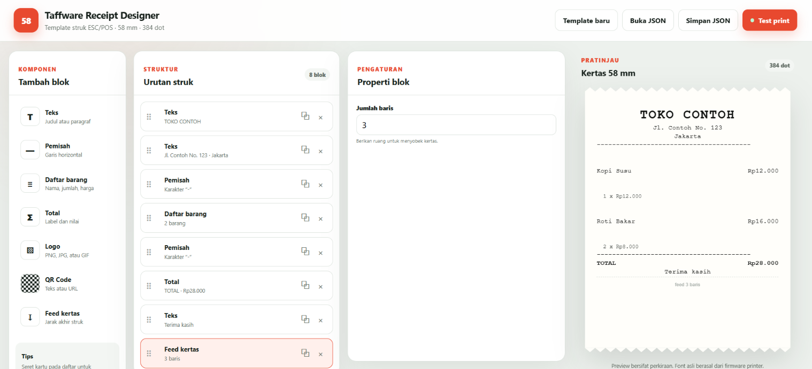

# Taffware Receipt Designer

GUI lokal untuk menyusun, menyimpan, melihat preview, dan mencetak struk ESC/POS pada printer thermal Taffware POS-58. Backend dibuat dengan Go, sedangkan antarmuka berjalan di browser lokal tanpa mengirimkan desain atau data transaksi ke internet.

<p align="center">
  
</p>

## Fitur

- Editor struk berbasis blok dengan drag-and-drop.
- Preview kertas 58 mm dengan area cetak 384 dot.
- Komponen teks, separator, daftar barang, total, logo, QR Code, dan paper feed.
- Alignment, bold, serta skala lebar dan tinggi teks.
- Konversi PNG, JPEG, atau GIF menjadi raster hitam-putih ESC/POS.
- Simpan dan buka desain sebagai template JSON.
- Test print langsung melalui USB `0416:5011`.
- Validasi template dan pesan error printer.

## Perangkat yang didukung

Konfigurasi bawaan ditujukan untuk:

| Komponen | Spesifikasi |
| --- | --- |
| Printer | Taffware thermal receipt printer POS-58 |
| Kertas | Thermal POS 58 mm |
| Area cetak | 384 dot |
| Protokol | ESC/POS |
| Antarmuka | USB Bulk OUT melalui libusb |
| Vendor ID | `0x0416` |
| Product ID | `0x5011` |

Printer ESC/POS lain dapat digunakan setelah menyesuaikan VID/PID pada [`internal/printer/usb.go`](internal/printer/usb.go).

## Persyaratan

- Go 1.25.4 atau lebih baru.
- libusb 1.0.
- Compiler C dan `pkg-config` untuk CGO.
- Driver WinUSB pada Windows, misalnya dipilih menggunakan [Zadig](https://zadig.akeo.ie/).

Saat WinUSB digunakan, printer mungkin tidak tersedia untuk aplikasi yang bergantung pada Windows print spooler. Aplikasi ini berkomunikasi langsung melalui libusb.

## Menjalankan aplikasi

Unduh dependency:

```bash
go mod download
```

Jalankan aplikasi:

```bash
go run .
```

Browser akan terbuka otomatis pada:

```text
http://127.0.0.1:8787
```

Gunakan opsi berikut jika browser tidak perlu dibuka otomatis:

```bash
go run . -no-browser
```

Alamat lokal juga dapat diganti:

```bash
go run . -addr 127.0.0.1:9000
```

## Membuat executable Windows

```bash
go build -o receipt-designer-taffware.exe .
```

Seluruh HTML, CSS, dan JavaScript ditanam ke executable menggunakan `go:embed`. Folder `static` tidak perlu disalin saat executable didistribusikan.

## Cara menggunakan

1. Jalankan aplikasi.
2. Tambahkan komponen melalui panel **Tambah blok**.
3. Pilih blok pada panel **Urutan struk**.
4. Ubah isi melalui panel **Properti blok**.
5. Seret kartu untuk mengatur urutan.
6. Periksa hasil pada panel **Pratinjau**.
7. Simpan desain melalui **Simpan JSON**.
8. Nyalakan dan hubungkan printer.
9. Klik **Test print**.

## Format template

Template disimpan sebagai JSON agar dapat digunakan kembali atau diproses oleh aplikasi lain.

```json
{
  "name": "Struk Taffware",
  "blocks": [
    {
      "id": "title",
      "type": "text",
      "text": "TOKO CONTOH",
      "align": "center",
      "bold": true,
      "width": 2,
      "height": 2
    },
    {
      "id": "separator",
      "type": "separator",
      "character": "-"
    },
    {
      "id": "total",
      "type": "total",
      "label": "TOTAL",
      "value": "Rp28.000"
    },
    {
      "id": "feed",
      "type": "feed",
      "lines": 3
    }
  ]
}
```

## API lokal

GUI menggunakan API yang hanya mendengarkan pada loopback `127.0.0.1`.

| Endpoint | Method | Fungsi |
| --- | --- | --- |
| `/api/info` | `GET` | Informasi printer dan lebar kertas |
| `/api/render` | `POST` | Memvalidasi template dan menghitung ukuran ESC/POS |
| `/api/print` | `POST` | Mengubah template lalu mengirimkannya ke printer |

## Pengolahan logo

Logo diperkecil secara proporsional hingga maksimum 384 dot, diubah menjadi hitam-putih, lalu dikemas sebagai raster ESC/POS `GS v 0`. Ukuran file pada GUI dibatasi 3 MB dan tinggi hasil raster maksimum 2048 dot.

## Batasan versi awal

- Preview menggunakan font browser sehingga tidak sepenuhnya identik dengan font internal printer.
- Teks dikonversi ke ASCII; karakter yang tidak tersedia diganti dengan `?`.
- QR pada preview merupakan placeholder. QR sebenarnya dibuat firmware printer saat dicetak.
- Belum tersedia variabel dinamis, undo/redo, barcode satu dimensi, atau editor posisi bebas.
- Aplikasi belum membaca status melalui endpoint USB `IN`.
- Tidak mengirim perintah auto-cut karena perangkat proyek menggunakan tear bar manual.

## Struktur proyek

```text
.
├── main.go
├── static/
│   ├── index.html
│   ├── app.css
│   └── app.js
├── internal/
│   ├── printer/usb.go
│   └── receipt/
│       ├── template.go
│       └── template_test.go
└── assets/
    └── receipt-designer-preview.png
```

Proyek komunikasi USB dasarnya tersedia di [octarudin/usb-thermal-printer](https://github.com/octarudin/usb-thermal-printer).
